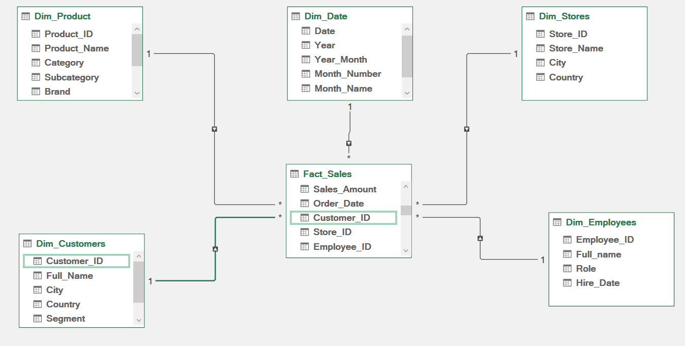
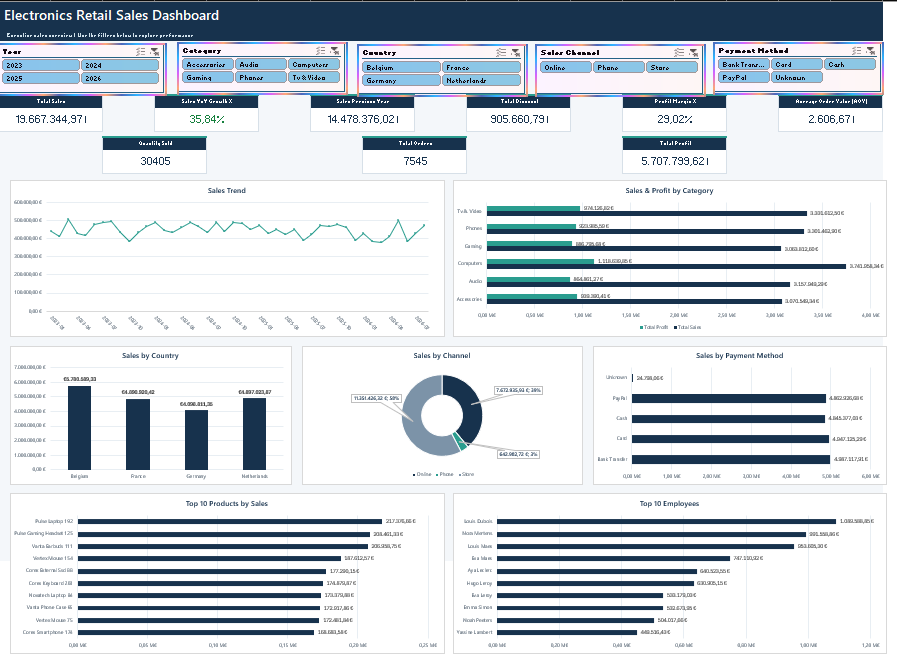

# Electronics Retail Sales Analytics | Excel BI Project

## Project Overview

This project presents an end-to-end Business Intelligence analysis of an electronics retail business using **Microsoft Excel, Power Query, Power Pivot, and DAX**.

The objective is to transform raw transactional data into a structured analytical model, monitor sales performance, evaluate profitability, and identify business improvement opportunities.

An interactive Excel dashboard was developed to analyze sales across products, countries, sales channels, payment methods, and employees.

## Tools & Technologies

- **Microsoft Excel** — Interactive dashboards, PivotTables, and PivotCharts
- **Power Query** — Data cleaning and transformation
- **Power Pivot** — Dimensional modeling and relationships
- **DAX** — Business measures, KPIs, and time intelligence
- **GitHub** — Project documentation and portfolio

## Data Preparation — Power Query

Power Query was used to prepare the source data for analysis.

The preparation workflow included:

- Checking data quality and consistency.
- Reviewing data types and missing values.
- Preparing transactional and reference tables.
- Structuring the data into fact and dimension tables.
- Preparing date attributes for time-based analysis.
- Loading the analytical tables into the Excel Data Model.

## Data Modeling — Star Schema

A star schema was implemented using Power Pivot.

The model contains **one fact table and five dimension tables**, connected through one-to-many relationships.

### Fact Table

**Fact_Sales**

The central fact table stores sales transactions and the keys required to connect them to the dimensions.

### Dimension Tables

| Dimension | Purpose |
|---|---|
| Dim_Product | Product, category, subcategory, and brand analysis |
| Dim_Date | Time-based analysis and year-over-year comparisons |
| Dim_Stores | Store and geographic performance |
| Dim_Customers | Customer and segment analysis |
| Dim_Employees | Employee sales performance |

### Data Model



The star schema supports consistent filtering, reusable DAX measures, and interactive analysis across multiple business dimensions.

## DAX Measures & KPIs

DAX measures were developed to calculate business performance indicators.

### Sales & Profitability

- **Total Sales** — Revenue from completed orders.
- **Total Profit** — Profit generated by completed orders.
- **Profit Margin %** — Total profit divided by total sales.
- **Total Orders** — Distinct count of completed orders.
- **Quantity Sold** — Quantity of products sold.
- **Average Order Value (AOV)** — Average revenue per order.
- **Total Discount** — Total discount amount.

### Time Intelligence

- **Sales Previous Year** — Sales for the corresponding period in the previous year.
- **Sales YoY Growth %** — Percentage change in sales compared with the previous year.

Time-intelligence calculations use DAX functions such as `CALCULATE` and `SAMEPERIODLASTYEAR`.

### Example DAX Measures

**Total Sales**

```dax
Total Sales =
CALCULATE(
    SUM(Fact_Sales[Sales_Amount]),
    Fact_Sales[Order_Status] = "Completed"
)
```

**Profit Margin**

```dax
Profit Margin % =
DIVIDE([Total Profit], [Total Sales])
```

**Sales Previous Year**

```dax
Sales Previous Year =
CALCULATE(
    [Total Sales],
    SAMEPERIODLASTYEAR(Dim_Date[Date])
)
```

**Sales YoY Growth**

```dax
Sales YoY Growth % =
DIVIDE(
    [Total Sales] - [Sales Previous Year],
    [Sales Previous Year]
)
```

## Interactive Sales Dashboard

The Excel dashboard provides a consolidated overview of retail business performance.



### Key Performance Indicators

The dashboard includes:

- Total Sales
- Total Profit
- Profit Margin %
- Total Orders
- Quantity Sold
- Average Order Value
- Sales Previous Year
- Sales YoY Growth %

### Business Analysis

**Sales Trend**

Monthly sales evolution to identify performance patterns and fluctuations.

**Sales & Profit by Category**

Comparison of revenue and profitability across electronics categories.

**Sales by Country**

Geographic comparison of retail sales performance.

**Sales by Channel**

Analysis of sales distribution across Online, Phone, and Store channels.

**Sales by Payment Method**

Comparison of revenue generated through different payment methods.

**Top 10 Products by Sales**

Identification of the best-performing products based on revenue.

**Top 10 Employees**

Ranking of employees by sales performance.

### Interactive Filters

The dashboard includes slicers for:

- Year
- Product Category
- Country
- Sales Channel
- Payment Method

These filters allow users to explore business performance dynamically.

## Key Business Insights

The dashboard provides several insights into the electronics retail business.

### 1. Sales Performance

Across the full reporting period, the dashboard reports approximately **€19.67 million in total sales** and **€5.71 million in total profit**, representing a profit margin of approximately **29.02%**.

### 2. Product Category Performance

The analysis compares revenue and profit across product categories, including Computers, Phones, Gaming, Audio, Accessories, and TV & Video.

This helps identify the categories contributing most to overall business performance.

### 3. Geographic Performance

Sales are analyzed across Belgium, France, Germany, and the Netherlands.

The geographic comparison highlights differences in revenue contribution between markets.

### 4. Sales Channel Performance

The dashboard compares Online, Phone, and Store sales channels to understand their contribution to total revenue.

### 5. Employee Performance

The Top 10 Employees analysis identifies leading employees by sales generated, supporting performance monitoring and further investigation.

## Business Recommendations

Based on the analytical framework, the following actions can be considered:

1. Investigate categories with high revenue but comparatively low profitability.
2. Monitor geographic differences to identify opportunities for commercial improvement.
3. Compare sales channels to support resource allocation decisions.
4. Review top-selling products to understand demand patterns.
5. Analyze employee performance alongside other relevant factors before making operational decisions.

## Project Structure

```text
Electronics-Retail-Sales-Analytics/
├── Electronics_Retail_Analysis.xlsx
├── Images/
│   ├── dashboard.png
│   └── data_model_excel.png
└── README.md
```

## Conclusion

This project demonstrates the practical application of Business Intelligence techniques within the Microsoft Excel ecosystem.

It covers data preparation, dimensional modeling, DAX measure development, business performance analysis, and interactive dashboard creation.

The project highlights the ability to transform transactional data into meaningful insights that can support business decision-making.
